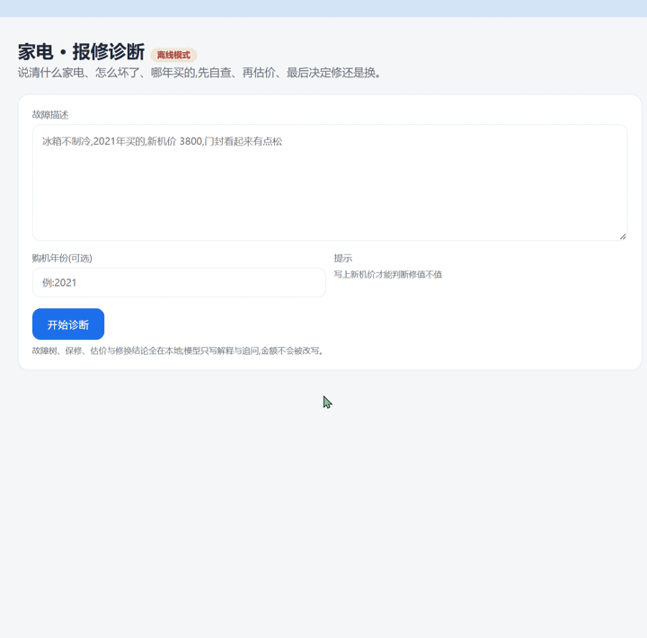
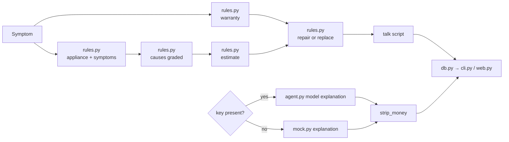

# JiaDian · Appliance Repair Advisor

[](https://github.com/wushiyi105-jpg/jiadian/actions) []() [](./LICENSE) [](https://codecov.io/gh/wushiyi105-jpg/jiadian)



> When an appliance breaks: work through the fault tree yourself, check the warranty, estimate the repair bill, decide repair or replace — and have the questions ready before the technician arrives.

The risky moment in a repair is not the work, it is **the quote**. The technician looks once and says "the compressor is gone, 900 to fix". You cannot tell whether that is fair, or whether a five-year-old machine is worth fixing at all. All of that is arithmetic: a fault tree narrows it down, the warranty says whether you pay, residual value decides repair versus replace.

**CLI + Web, zero third-party dependencies.**

## ✨ Features

- 🧰 **10 appliance fault trees** — fridge, washer, AC, TV, water heater, hood, dishwasher, microwave, robot vacuum, water purifier, 40 possible causes
- 🟢 **Self-check vs must-repair** — each cause is graded; self-check items come first and can save a call-out fee
- 📅 **Warranty check** — whole unit 1 year, main parts 3 years, compressor/motor 10 years (brand dependent), computed from the purchase year
- 💰 **Repair estimate** — parts plus labour range per cause, with a total for the must-repair items
- 🤔 **Repair or replace** — residual = `new price × 0.55^years` (floor 5%); repair ceiling ≥ residual means replace; ≥35% of new price leans replace; ≤15% repair
- ⚠️ **Safety limits** — refrigerant, gas, high-voltage capacitors and outdoor units are never DIY
- 📞 **Call script** — call-out fee, parts, tax, post-repair warranty, trade-in, one line each
- 📋 **Pre-call checklist** — model, purchase year, symptoms, self-checks done, prior disassembly, installation environment
- 🔒 **Costs are local-only** — the model writes explanations and follow-up questions; amounts are replaced by `strip_money`

## 🚀 Quick start

```bash
git clone https://github.com/wushiyi105-jpg/jiadian.git
cd jiadian

cp .env.example .env      # optional: LLM_API_KEY

python -m jiadian diagnose --text "Fridge not cooling, bought 2021, new price 3800, door seal looks loose"
```

Or keep it in `fault.txt` and run `python -m jiadian diagnose --file fault.txt --save`.

Docker:

```bash
docker build -t jiadian .
docker run -p 8000:8000 jiadian
```

## 🤔 Why not just ask a general LLM

A general model says "could be the compressor, contact service". It will not tell you whether the machine is worth fixing, and it will not ask the price for you. Four differences:

1. **The verdict is calculated** — `rules.residual()` computes `new price × 0.55^years` (floor 5%), `rules.decision()` compares the repair ceiling against residual and new price: 900 repair vs 191 residual → replace; 600 vs 908 and 20% of new price → depends. Every verdict can be recomputed.
2. **Warranty comes before the quote** — `rules.warranty()` marks whole unit / main parts / compressor by purchase year. An AC bought in 2025 yields "claim the warranty first", not "pay 600 to fix". That saves more than any bargaining.
3. **Self-checks come first** — half of the 40 causes are filters, door seals, drain hoses and wrong settings, fixable in ten minutes. A general model jumps straight to "call service", and you pay the call-out.
4. **Works offline** — fault tree, warranty, estimate, verdict, script and checklist are local; without a key you only lose the model's explanation.

## 🎯 Use cases

- **The technician quotes a big number**: enter appliance, symptom, purchase year and new price, compare repair ceiling with residual, then decide repair, replace, or just pay the call-out.
- **Not sure about warranty**: a 2023 washer still has main parts cover; get the official check before a neighbourhood shop touches it.
- **Want to try it yourself first**: fridge door seal and setting, AC filter, hood backdraft valve — all zero cost.
- **Afraid of being overcharged**: the call script asks call-out fee, parts, tax, warranty and trade-in up front.

## 🗺 Roadmap

- **Brand warranty library**: unit/compressor years by brand and model, beyond the generic three-pack rules.
- **Parts price reference**: market ranges for compressors, control boards, motors, to flag inflated parts quotes.
- **Repair ledger**: per-machine history of repairs and parts, to judge when replacement is due.
- **Trade-in maths**: platform subsidy plus old-machine credit, giving a total replacement cost.
- **Photo guidance**: what to photograph per fault (nameplate, filter, error code) to reduce guesswork.

## ❓ FAQ

**No purchase year?**
Warranty cannot be judged, only the fault tree and estimate. Pass `--buy-year 2021`, or write "bought in 2021" / "last year".

**Is the estimate accurate?**
It is a reference range for common parts and labour, not a local quote. Its job is to judge magnitude: 900 against a 191 residual tells you instantly whether it is worth it.

**Why is the verdict sometimes "claim warranty first"?**
Within the 1-year unit or 3-year main-parts cover, an official inspection is usually free or costs only the call-out. Note that DIY disassembly or non-official repair voids the warranty.

**Can I repair a gas water heater myself?**
No. Gas, refrigerant, high-voltage capacitors and outdoor units are must-repair items; the tool only gives safety limits, never disassembly steps.

**Will the model change the cost?**
No. `agent.strip_money()` replaces any "N yuan" in model output; amounts come only from `rules.estimate()`.

## 📖 Commands

```bash
# 🔧 diagnose
python -m jiadian diagnose --text "..." --buy-year 2021
python -m jiadian diagnose --file fault.txt --save

# 🧰 fault tree
python -m jiadian faults --grep AC

# 📅 warranty rules
python -m jiadian warranty

# 🗂 history
python -m jiadian history

# 🌐 web
python -m jiadian web --port 8000

python -m jiadian --json diagnose --text "..."
python -m jiadian --mock diagnose --text "..."
```

## 🔌 Model configuration

Any **OpenAI-style `/chat/completions`** endpoint:

| Platform | `LLM_BASE_URL` | `LLM_MODEL` |
|---|---|---|
| DeepSeek (default) | `https://api.deepseek.com` | `deepseek-flash` |
| OpenAI | `https://api.openai.com/v1` | `gpt-4o-mini` |
| Local Ollama | `http://localhost:11434/v1` | `qwen2.5` |

## 🧠 How it works

```
symptom + purchase year + new price
  │
  ├─ rules.detect ──────── 10 appliances by symptom keywords
  ├─ rules.causes_for ──── 40 causes, self-check first
  ├─ rules.warranty ────── unit / main parts / compressor
  ├─ rules.estimate ────── parts + labour range
  ├─ rules.residual ────── new price × 0.55^years, floor 5%
  ├─ rules.decision ────── warranty → residual → 35%/15% lines
  ├─ rules.talk_script ─── call-out / parts / tax / warranty / trade-in
  │
  ├─ model: explanation / risks / questions (strip_money)
  └─ offline: mock.py assembles from fault tree and safety
  │
  └─ SQLite → CLI / Web
```

### Data flow



## 🗂 Layout

```
jiadian/
├── jiadian/
│   ├── rules.py    # fault tree, warranty, estimate, residual, verdict, script
│   ├── agent.py    # orchestration + cost stripping
│   ├── mock.py     # offline explanation
│   ├── db.py       # repair records
│   ├── cli.py      # diagnose / faults / warranty / history / web
│   └── web.py      # single page + JSON API
├── data/faults.json  # 10 fault trees + warranty rules
├── tests/test_jiadian.py
└── assets/demo.gif
```

## ✅ Tests

```bash
python -m unittest discover tests -v
```

27 tests cover local logic only: appliance detection, self-check ordering, three purchase-year formats, warranty states, estimate range, residual floor, three verdict lines, script elements, checklist, offline pipeline and cost stripping. CI runs them on 3.10/3.11/3.12.

## 👤 Author

Xiao Mi · 17612850106

## 📄 License

[MIT](./LICENSE)
