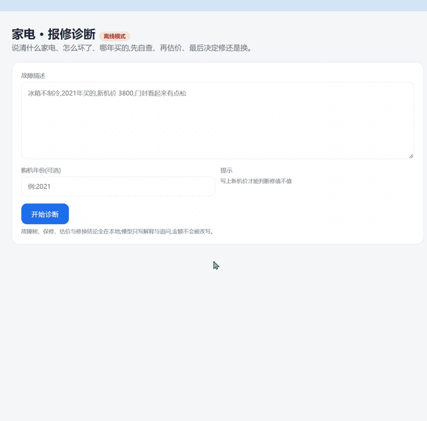
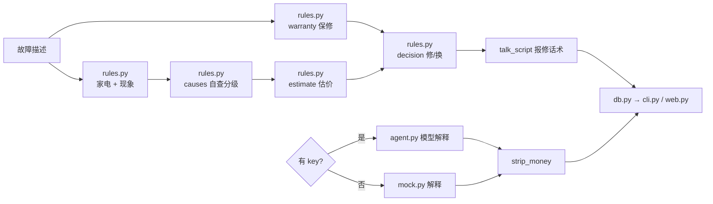

# 家电 · 报修诊断

[](https://github.com/wushiyi105-jpg/jiadian/actions) []() [](./LICENSE) [](https://codecov.io/gh/wushiyi105-jpg/jiadian)



> 家电坏了先别急着叫人:先按故障树自查,再算保修、估维修费,最后判断修还是换,顺手把报修话术写好。

报修最容易被坑的环节不是修,是**报价**。师傅上门看一眼就说「压缩机坏了,修 900」,你既不知道这个价合不合理,也不知道这台用了五年的机器还值不值得修。这几件事其实都能算:故障树缩小范围,保修期判断该不该花钱,残值对比决定修还是换。

**CLI + Web,零第三方依赖。**

## ✨ 特性

- 🧰 **10 类家电故障树** — 冰箱、洗衣机、空调、电视、热水器、油烟机、洗碗机、微波炉、扫地机、净水器,共 40 条可能原因
- 🟢 **自查与报修分级** — 每条原因标「可自查 / 必须报修」,自查项排在前面,能省一次上门费
- 📅 **保修判定** — 整机 1 年、主要部件 3 年、压缩机/电机 10 年(部分品牌),按购机年份算在保与剩余年限
- 💰 **维修估价** — 按故障原因给出配件+人工区间,合计参考取必须报修项的下限到上限
- 🤔 **修还是换** — 残值 = 新机价 × 0.55^年(下限 5%),维修上限 ≥ 残值直接换;占新机价 ≥35% 倾向换;≤15% 修
- ⚠️ **安全禁忌** — 制冷剂、燃气、高压电容、高空外机,该报修的绝不建议自己拆
- 📞 **报修话术** — 先问上门费、配件费、是否含税、修后保修、旧机折抵,一句话一条
- 📋 **报修前体检** — 型号、购机年份、故障现象、已自查项、是否拆过、安装环境
- 🔒 **费用只认本地** — 模型只写解释与追问,输出里的金额被 `strip_money` 替换

## 🚀 快速开始

```bash
git clone https://github.com/wushiyi105-jpg/jiadian.git
cd jiadian

cp .env.example .env      # 可选:LLM_API_KEY

python -m jiadian diagnose --text "冰箱不制冷,2021年买的,新机价 3800,门封有点松"
```

也可以写进 `fault.txt`:`python -m jiadian diagnose --file fault.txt --save`。

Docker:

```bash
docker build -t jiadian .
docker run -p 8000:8000 jiadian
```

## 🤔 为什么不用通用大模型直接问

通用模型会说「可能是压缩机问题,建议联系售后」。它不会告诉你这台还值不值得修,也不会替你问价。差别在四点:

1. **修换结论是算出来的** — `rules.residual()` 用 `新机价 × 0.55^年` 算残值(下限 5%),`rules.decision()` 拿维修上限与残值、新机价两条线比:900 元维修 vs 191 元残值 → 直接换新;600 元 vs 908 元残值、占新机价 20% → 看情况。每个结论都能复算,不是「感觉不划算」。
2. **保修先于报价** — `rules.warranty()` 按购机年份给出整机/主要部件/压缩机的在保状态。2025 年买的空调,结论是「先走保修」而不是「花 600 修」,这一条能省下的钱比任何砍价都多。
3. **自查项排在报修前** — 40 条原因里一半是滤网、门封、排水管、设置错误,自己十分钟能排除。模型通常直接跳到「联系售后」,白白付出上门费。
4. **断网也能用** — 故障树、保修、估价、修换、话术、体检全在本地;没有 key 只少模型写的解释与追问。

## 🎯 适用场景

- **师傅报了个高价**:把家电、现象、购机年份、新机价输进去,看维修上限与残值,再决定是修、是换,还是只付上门费走人。
- **不确定在不在保**:2023 年买的洗衣机,主要部件还在 3 年内,先让官方检测,别找楼下维修点。
- **想先自己试试**:冰箱不制冷先查门封与档位,空调不凉先洗滤网,油烟机吸力小先看止逆阀,都是零成本。
- **怕遇到加价**:用报修话术把上门费、配件费、含税、修后保修一次问清,避免「先修后报价」。

## 🗺 Roadmap

- **品牌保修条款库**:按品牌与型号区分整机/压缩机年限,现在只给通用三包口径。
- **配件价格参照**:常见压缩机、电脑板、电机的市场价区间,识别「配件费虚高」。
- **维修记录台账**:同一台机器的历次维修、更换件与费用,判断是否该整机换新。
- **以旧换新测算**:叠加平台补贴与旧机折抵,给出换新总成本对比。
- **拍照辅助判断**:按故障类型提示拍哪里(铭牌、滤网、错误码),减少描述偏差。

## ❓ FAQ

**没写购机年份怎么办?**
保修判不了,只能给故障树与估价。用 `--buy-year 2021` 指定,或在描述里写「2021年买的」「去年买的」。

**维修估价准吗?**
是按常见配件与人工区间给的参考,不代表本地报价。它的用途是判断量级:900 元的报价对应 191 元残值,值不值得修一眼就能看出来。

**为什么有时结论是「先走保修」?**
整机 1 年、主要部件 3 年还在保内时,官方检测通常免费或只收上门费,先保修再谈自费维修。注意:私拆或非官方维修会失去保修。

**燃气热水器能自己修吗?**
不能。燃气类、制冷剂、高压电容、高空外机都属于必须报修项,工具只给安全禁忌,不给拆解步骤。

**模型会不会改费用?**
不会。`agent.strip_money()` 把模型输出里的「N 元」替换成「该费用」,金额只来自 `rules.estimate()`。

## 📖 命令参考

```bash
# 🔧 诊断
python -m jiadian diagnose --text "..." --buy-year 2021
python -m jiadian diagnose --file fault.txt --save

# 🧰 故障树
python -m jiadian faults --grep 空调

# 📅 保修口径
python -m jiadian warranty

# 🗂 历史
python -m jiadian history

# 🌐 Web
python -m jiadian web --port 8000

python -m jiadian --json diagnose --text "..."
python -m jiadian --mock diagnose --text "..."
```

## 🔌 模型接入

兼容 **OpenAI `/chat/completions`** 的任意服务:

| 平台 | `LLM_BASE_URL` | `LLM_MODEL` |
|---|---|---|
| DeepSeek(默认) | `https://api.deepseek.com` | `deepseek-flash` |
| OpenAI | `https://api.openai.com/v1` | `gpt-4o-mini` |
| 本地 Ollama | `http://localhost:11434/v1` | `qwen2.5` |

## 🧠 工作原理

```
故障描述 + 购机年份 + 新机价
  │
  ├─ rules.detect ──────── 10 类家电,现象关键词命中
  ├─ rules.causes_for ──── 40 条原因,自查优先排序
  ├─ rules.warranty ────── 整机/主要部件/压缩机在保判定
  ├─ rules.estimate ────── 必须报修项的配件+人工区间
  ├─ rules.residual ────── 新机价 × 0.55^年,下限 5%
  ├─ rules.decision ────── 保修 → 残值 → 35%/15% 三条线
  ├─ rules.talk_script ─── 上门费/配件费/含税/保修/折抵
  │
  ├─ 模型:解释 / 风险 / 追问(strip_money)
  └─ 离线:mock.py 按故障树与安全禁忌组装
  │
  └─ SQLite → CLI / Web
```

### 数据流



## 🗂 目录结构

```
jiadian/
├── jiadian/
│   ├── rules.py    # 故障树、保修、估价、残值、修换、话术
│   ├── agent.py    # 编排 + 费用剥离
│   ├── mock.py     # 离线解释与追问
│   ├── db.py       # 报修记录
│   ├── cli.py      # diagnose / faults / warranty / history / web
│   └── web.py      # 单页 + JSON API
├── data/faults.json  # 10 类故障树 + 保修口径
├── examples/         # 4 份真实描述 + 对应输出
├── tests/
│   ├── test_jiadian.py       # 规则层单测
│   └── test_integration.py   # HTTP / 模型层 / CLI 三条链路
├── docs/regression-map.md    # 问题 → 测试名对照
└── assets/demo.gif
```

## 📂 真实示例

`examples/` 四份都是照抄的原话，不是编的：

| 文件 | 场景 | 分支 |
| --- | --- | --- |
| `case-01.txt` | 业主群：客厅挂机五年不制冷，外机噪音大 | 过保 → 换新（修 600 已超残值 146） |
| `case-02.txt` | 微信里发给师傅：冰箱化冻，2023 年买 | 主要部件在保 → 先走保修 |
| `case-03.txt` | 租客报修：洗衣机不排水还漏水，去年买 | 整机在保 → 先走保修 |
| `case-04.txt` | 电话口述：燃气热水器打不着火，发票丢了 | 保修未知 + 燃气安全禁忌 |

命令行跑一遍就出 `examples/out/case-0N.md`，可直接对照。重新生成：

```bash
for f in examples/case-0*.txt; do
  n=$(basename "$f" .txt)
  python -m jiadian --mock diagnose --file "$f" > "examples/out/$n.md"
done
```

## ✅ 测试

```bash
python -m unittest discover tests -v
```

45 个测试分两层：27 个单测只测本地逻辑（家电识别、自查排序、购机年份三种写法、在保/过保/压缩机、估价区间、残值下限、三条结论线、话术要素、体检项、离线全流程、金额剥离），18 个集成测试真起 HTTP 服务、真调子进程 CLI、真按本仓 schema 回一次模型。CI 在 3.10/3.11/3.12 上跑。


## 👤 作者

shiyi · GitHub [@wushiyi105-jpg](https://github.com/wushiyi105-jpg) · [wushiyi105@gmail.com](mailto:wushiyi105@gmail.com)

## 📄 License

[MIT](./LICENSE)
